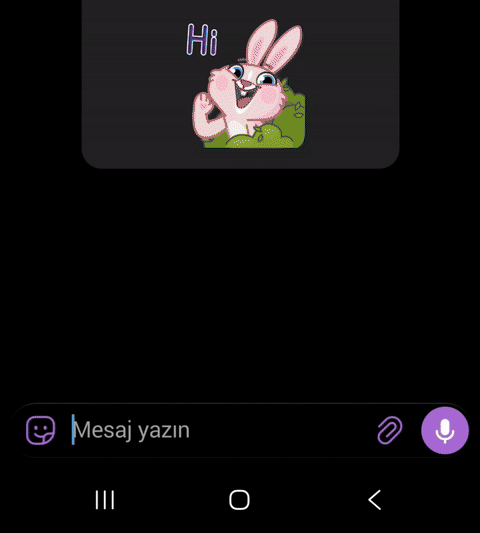

Live preview: https://unsupportedx.github.io/gboard-notes/

# Gboard Changes

Three small changes to make Gboard easier to use.

Base version: Gboard 18.5.6 beta · Changes were made on this version

## No clipboard limit

Copied items stay in the clipboard. They are not deleted after a short time, and new items do not push out the old ones.

## Microphone stays on for 60 seconds

Voice typing waits for you. The microphone does not turn off after a few seconds — it stays on for a full minute.

## Always-on microphone

The microphone opens by itself when the keyboard opens. No need to tap the microphone button every time.

## How it was done

| Change | Technical detail |
| --- | --- |
| Clipboard | Item limit raised to 100; auto-expiry removed. |
| Microphone — 60 seconds | Listening timeout changed from 5 seconds to 60 seconds. |
| Always-on microphone | Auto-start gates (wee.o / wee.n) enabled, so the microphone starts when the keyboard opens. |

## Why it isn't published

This is a modified Google app, so it is not published as an APK. There is no release — this page is only a description.

## Test video

## Tags

- Gboard clipboard limit
- Gboard clipboard history
- clipboard history
- Gboard clipboard limit 100
- Gboard clipboard limit problem
- Gboard clipboard items disappearing
- Gboard clipboard history not saving
- Gboard clipboard keeps clearing
- Gboard clipboard keeps deleting items
- Gboard clipboard items deleted automatically
- Gboard clipboard history keeps disappearing
- Gboard clipboard not saving copied items
- Gboard clipboard clears itself
- Gboard clipboard empties itself
- Gboard clipboard items vanish after copy
- Gboard copied items disappear from clipboard
- Gboard clipboard only saves a few items
- Gboard clipboard limit too low
- Gboard clipboard history limit
- Gboard clipboard history empty
- Gboard clipboard history missing
- Gboard clipboard history not working
- Gboard clipboard not keeping history
- Gboard clipboard items expire too fast
- Gboard clipboard auto delete problem
- Gboard clipboard loses copied text
- Gboard clipboard pasted items gone
- Gboard clipboard stops saving
- how to increase Gboard clipboard limit
- how to keep Gboard clipboard history
- how to stop Gboard clipboard from clearing
- how to stop Gboard from deleting clipboard items
- how to save more items in Gboard clipboard
- Gboard clipboard unlimited items
- Gboard clipboard keep items longer
- voice typing auto start
- always on microphone
- microphone timeout 60 seconds
- Gboard voice input auto open
- Gboard voice typing timeout
- Gboard microphone turns off too quickly
- Gboard keep microphone on
- Gboard microphone auto start
- Gboard voice typing stops while speaking
- Gboard microphone closes after 5 seconds
- Gboard microphone keeps turning off
- how to keep Gboard microphone open
- Gboard auto voice typing not working
- Gboard voice typing stops mid sentence
- Gboard microphone turns off while talking
- Gboard voice input stops listening
- Gboard voice typing keeps stopping
- Gboard dictation keeps stopping
- Gboard microphone shuts off automatically
- Gboard microphone closes by itself
- Gboard microphone timeout too short
- Gboard voice typing time limit
- Gboard voice typing timeout problem
- Gboard speech to text stops automatically
- Gboard voice input not staying on
- Gboard microphone stops while dictating
- Gboard voice typing closes on its own
- Gboard microphone disconnects while speaking
- Gboard voice typing not working properly
- Gboard voice typing stops after a few seconds
- Gboard microphone only stays on 5 seconds
- how to extend Gboard voice typing time
- how to make Gboard microphone stay on longer
- how to stop Gboard microphone from turning off
- how to keep voice typing on in Gboard
- Gboard microphone always on
- Gboard voice typing auto open not working
- Gboard keyboard microphone auto start
- Gboard 18.5.6 beta
